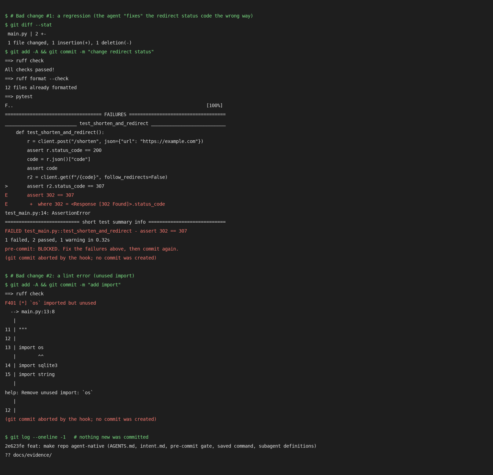

# Week 5 Write-up — Structuring a Repo for Agents: The Link Shortener

**Student:** Mohanad Kadadou (2309115218) · **Agent:** Claude Code (Claude Sonnet 5.5) · **Stack:** FastAPI + SQLite, Python 3.12, ruff, pytest

The starter app was imported unchanged (`git log`: first commit), then made agent-ready and used for one task (task 2, click counter). Every step below is a commit: `git log --oneline`.

## Artifacts and the agent feature each one maps to
| # | Artifact | What it does | Mapped to (Claude Code; Antigravity/Gemini equivalent) |
|---|---|---|---|
| 1 | [`AGENTS.md`](AGENTS.md) | Cross-tool instructions: run/test/lint commands, where things live, conventions (parameterised SQL, type hints), the *new endpoint* workflow (plan → failing test → implement → gate → review), **safe / ask-first / forbidden** command lists, and known gotchas (shared `links.db`, import-time `init_db()`, SQLite ≥ 3.35). | Claude Code loads `CLAUDE.md`; mine is one line, `@AGENTS.md`, so both tools read the same file. (Gemini CLI/Antigravity: `GEMINI.md`/`AGENTS.md`.) |
| 2 | [`intent.md`](intent.md) | The *why*: purpose, success, **5 invariants** (http/https only, stable codes, parameterised SQL, data survives upgrades, one indexed lookup), non-goals, decision rules. Agents and reviewers check changes against it. | Referenced from `AGENTS.md` ("read first") and from the reviewer subagent. Plain context file, same in every agent. |
| 3 | **Hook:** [`.githooks/pre-commit`](.githooks/pre-commit) → [`scripts/check.sh`](scripts/check.sh) | Runs `ruff check`, `ruff format --check`, `pytest -q` and **blocks** the commit (exit 1) if any fails. Enabled by `git config core.hooksPath .githooks`; `AGENTS.md` forbids `--no-verify`. | A *git* hook, so it gates every agent and every human. (Claude Code's own `PostToolUse`/`Stop` hooks in `settings.json` or Gemini CLI hooks could call the same `scripts/check.sh`; I kept the git hook because it cannot be skipped by switching tools.) |
| 4 | **Reusable workflow:** [`.claude/commands/test-summary.md`](.claude/commands/test-summary.md) + [`docs/PLAYBOOKS.md`](docs/PLAYBOOKS.md) | "Run the gate and summarize": verdict, first failing stage, per-test cause, next command; read-only. PLAYBOOKS also holds the *new endpoint* playbook and the hook demo. | Claude Code **custom slash command** (`/test-summary`) with `allowed-tools` limits. Equivalent: Gemini CLI custom commands (`.gemini/commands/*.toml`), Antigravity workflows. |
| 5 | **Subagents:** [`.claude/agents/planner.md`](.claude/agents/planner.md), [`implementer.md`](.claude/agents/implementer.md), [`reviewer.md`](.claude/agents/reviewer.md) | Role-specialised agents: planner (read-only tools), implementer (edit + bash), reviewer (read-only). | Claude Code **subagents** (`.claude/agents/*.md`, with per-agent tool allow-lists). Equivalent: Gemini CLI sub-agents / Antigravity Agent Manager parallel agents. |

> **Honesty note on how the subagents were run.** The agent files above define the three roles and are committed for future sessions, but Claude Code only discovers `.claude/agents/` at session start. In this session I therefore launched each role with the Agent tool using the same instructions in the prompt (planner = the read-only `Plan` agent type; implementer and reviewer = `general-purpose` subagents told to be edit-capable and read-only respectively). The reviewer's read-only rule was enforced by instruction, not by the tool allow-list. Likewise I ran the `/test-summary` steps by hand (`scripts/check.sh`) rather than invoking the slash command.

## Hook blocking a failing change (evidence)

Rendered from the real captured terminal output in [`docs/evidence/hook-blocking.txt`](docs/evidence/hook-blocking.txt) (an image of text, not a screen capture). Two bad changes were tried: (1) flipping the redirect status to 302 → `1 failed, 2 passed` → `pre-commit: BLOCKED`; (2) adding an unused `import os` → `F401` from ruff → blocked. In both cases `git log` still shows the previous commit (nothing was created), and the changes were then reverted. The hook also ran (and passed) on every later commit, including the feature commit, and **it caught two over-long comment lines (E501) that I introduced while applying the reviewer's fixes**, before the commit was allowed.

## Subagent transcript: planner → implementer → reviewer on task 2 (click counter)
Full transcripts: [`01-planner.md`](docs/transcripts/01-planner.md), [`02-implementer.md`](docs/transcripts/02-implementer.md), [`03-reviewer.md`](docs/transcripts/03-reviewer.md). Summary:

1. **Planner** (read-only): read `AGENTS.md`, `intent.md`, `main.py`, tests and the backlog, then produced a plan with: route order (`/stats/{code}` before the catch-all), 404 for unknown codes and *stats never counts as a click*, a schema change with an **idempotent migration for an existing `links.db`** (`PRAGMA table_info` + `ALTER TABLE ADD COLUMN … DEFAULT 0`, never drop/recreate), an **atomic** increment (`UPDATE … SET clicks = clicks + 1`), 10 order-independent tests to write first (including a migration test on a temp old-schema DB), and risks mapped to `intent.md` invariants. It stopped at "schema changes need approval" (that rule comes from `AGENTS.md`).
2. **Human gate:** approved with two clarifications (write errors propagate; use `RETURNING` only on SQLite ≥ 3.35, which I checked: 3.53.1). *Transparency:* the approval was given by me, Claude Code driving the session on the student's behalf; the student can override it.
3. **Implementer:** wrote 9 new tests first and showed the failing run (8 failed / 4 passed, none an import error, each failing for the predicted reason: 404 for the missing route, `KeyError: 'clicks'`, `no such column: clicks`), then implemented the plan and made `scripts/check.sh` pass (12 tests). I re-read the diff and re-ran the gate instead of trusting the report.
4. **Reviewer** (read-only): found no blockers and returned APPROVE, with real findings: **SHOULD-FIX** `RETURNING` needs SQLite ≥ 3.35 (older systems would 500 on every redirect) and the cursor should be closed before commit; **NIT** one test (`stats_route_not_shadowed`) was vacuous because `/stats/x` can never match `/{code}`, and the concurrency test would also pass with a non-atomic implementation.
5. **I accepted the diff only after fixing** findings 1, 2, 3 and 7 (fail-fast SQLite check + documented requirement, cursor closed, vacuous test replaced by `/stats` → 404, stale docs updated) and recorded my decision on each finding in `03-reviewer.md`.

Final state: `GET /stats/{code}` → `{"url","clicks"}`; `GET /{code}` still 307 and now atomically counts; migration verified on an old-schema DB; 12 tests passing (3 original untouched + 9 new).

## What I learned
Structuring a repo for agents means moving the rules out of my head and into files that load every session and into gates that nobody can forget: `AGENTS.md` + `intent.md` told the planner about the shared `links.db` and the "migrate, never drop" invariant, so its plan already contained a migration and order-independent tests, something a bare "add a click counter" prompt would likely have skipped. The pre-commit hook mattered more than the prose rules, because it is deterministic: it stopped bad commits from me as well as from the subagents. The planner/implementer/reviewer split worked best because each role had different tools and a different job: the reviewer found a portability bug (SQLite 3.35) and a worthless test that the implementer, who had just written both, did not flag; and the human gate was the point where I could still change the plan. The caveat is trust: a subagent's report is only a claim, so I verified the diff and re-ran the gate myself.
